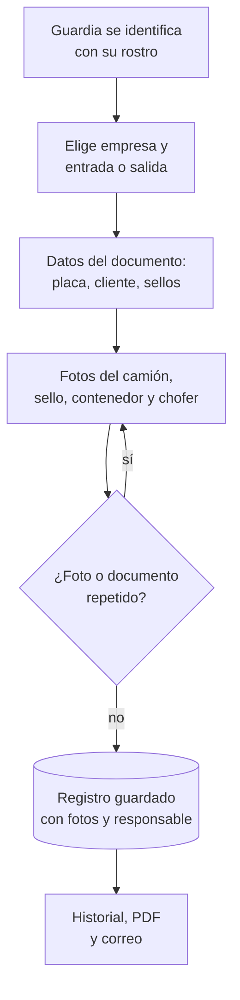
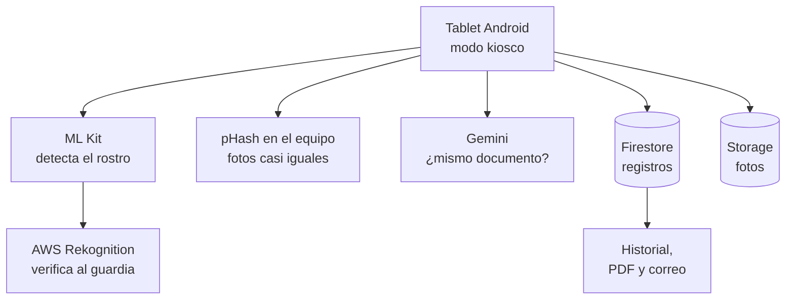
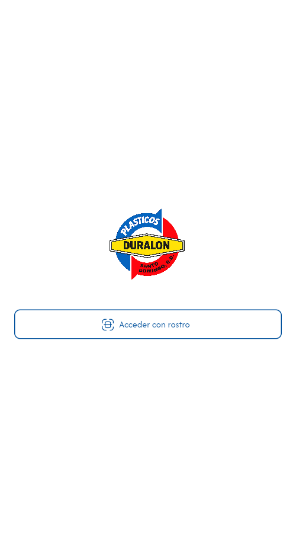

# JF Control de Acceso · Caso de estudio

> **Este repositorio es un caso de estudio, no contiene código.** El sistema es propiedad de la empresa donde está en producción y su código permanece privado. Aquí se muestra el problema, la solución y cómo funciona.
>
> 🎬 Más proyectos: **[portafolio de Yeison Rojas](https://ai-automation-portfolio-cyan.vercel.app)**

App de garita en modo kiosco para registrar la entrada y salida de camiones con fotos, documentos y el guardia identificado por su rostro.

## El reto

En la garita se necesitaba un registro confiable de cada camión que entra o sale: quién lo registró, con qué documentos, placas y sellos, y con fotos que lo prueben. El sistema tenía que impedir registros incompletos o con fotos repetidas.

## La solución

- **El guardia entra con su rostro** y queda como responsable de cada registro. La sesión vence a la hora.
- **Registro guiado paso a paso** (empresa → entrada o salida → datos del documento → fotos). El camino cambia según el caso: entrada, salida vacía, salida con carga o materia prima.
- **Varios documentos por camión** (conduces o facturas), cada uno con su placa, cliente y hasta 4 sellos. Si hay varias placas, las fotos se piden por placa.
- **Fotos obligatorias** de transporte, sello, contenedor y cédula del chofer, según el flujo.
- **Control de fotos repetidas en dos capas:** una huella perceptual (pHash) en el propio equipo detecta imágenes casi iguales, y un modelo de IA (Gemini) revisa si dos fotos muestran el mismo documento. Además se comparan los textos de los documentos para detectar duplicados.
- **Modo kiosco** en tablets Android: la app no se puede cerrar sin el PIN de administración.
- **Historial con exportación** a PDF y por correo, y panel de administración para gestionar los rostros registrados.

## Cómo funciona

## Arquitectura

## Decisiones técnicas

- **Dos capas contra fotos repetidas:** primero una huella perceptual (pHash) calculada en el propio equipo sobre miniaturas, rápida y sin internet; después Gemini revisa todas las fotos en una sola llamada para detectar el mismo documento fotografiado dos veces.
- **Si la IA no responde, el guardia no se queda trabado:** la revisión con Gemini es una capa extra y el registro puede continuar.
- **Duplicados por texto:** los textos de los documentos se comparan con similitud de Jaccard para detectar el mismo conduce o factura registrado dos veces.
- **Modo kiosco real** con el Lock Task de Android: la app no se puede cerrar sin el PIN de administración.
- **Sesión con vencimiento doble:** un temporizador mientras la app está abierta y una verificación al volver a ella, para que nadie registre a nombre de otro guardia.

## Mi rol

Creador y arquitecto del sistema. Definí la arquitectura y el producto y dirigí al equipo que lo desarrolló: flujo de registro con sus variantes, login facial, detección de fotos y documentos repetidos con pHash e IA, modo kiosco, historial y exportación.

## Stack

Flutter (Android en modo kiosco / Lock Task) · Firebase (Firestore, Storage, Cloud Functions) · ML Kit (detección de rostro) · AWS Rekognition (reconocimiento facial) · Google Gemini (análisis de imágenes) · pHash · PDF

## Captura

---

## English summary

**JF Access Control** is a kiosk-mode Android app for the guard post. It registers every truck that enters or leaves with documents, plates, seals and photos, and identifies the guard by face.

Registration is a guided, branching flow (entry, empty exit, loaded exit, raw material). A truck can carry several documents, each with its own plate, customer and up to 4 seals. Repeated photos are blocked in two layers: an on-device perceptual hash (pHash) for near-identical images, and an AI model (Gemini) that checks whether two photos show the same document; document texts are also compared to catch duplicates. The app runs in Android lock-task mode, and records can be exported to PDF or sent by email.

**Key engineering decisions:**
- Two-layer duplicate-photo detection: on-device pHash plus a single Gemini call.
- Fail-open AI check so the guard is never blocked.
- Jaccard text similarity to catch duplicated documents.
- Android lock-task kiosk mode and a one-hour session.

**My role:** creator and architect of the system. I defined the architecture and the product and led the team that built it.

**Stack:** Flutter (Android kiosk), Firebase, AWS Rekognition, Google Gemini, pHash.

*This is a case study. The source code belongs to the company and stays private.*
